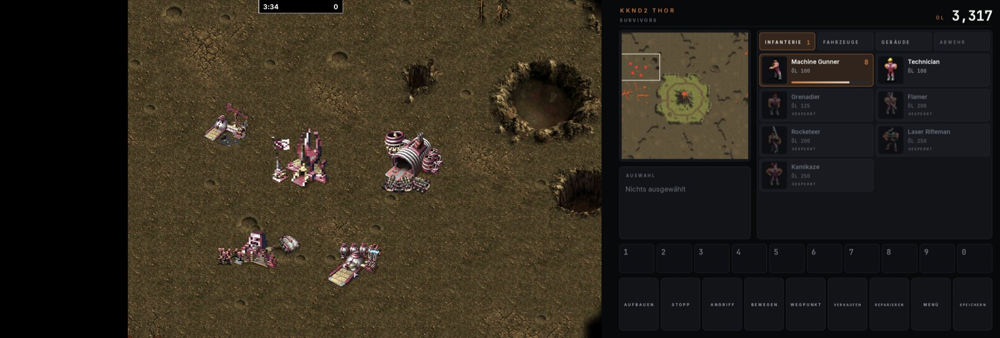
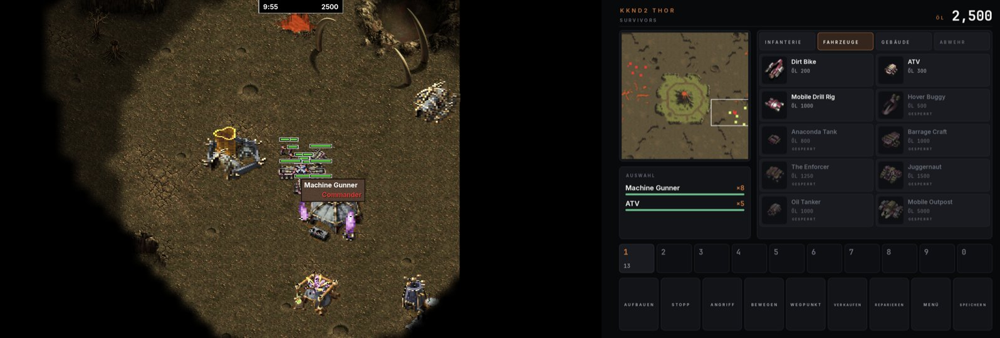
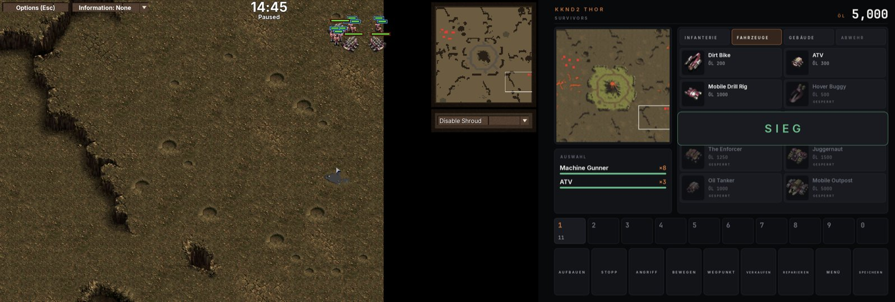
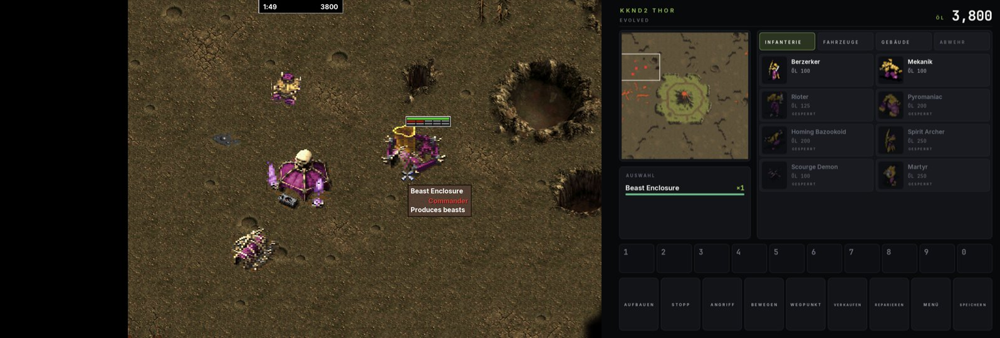
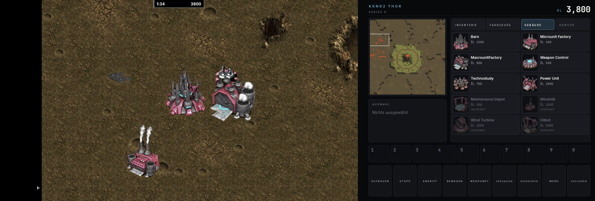
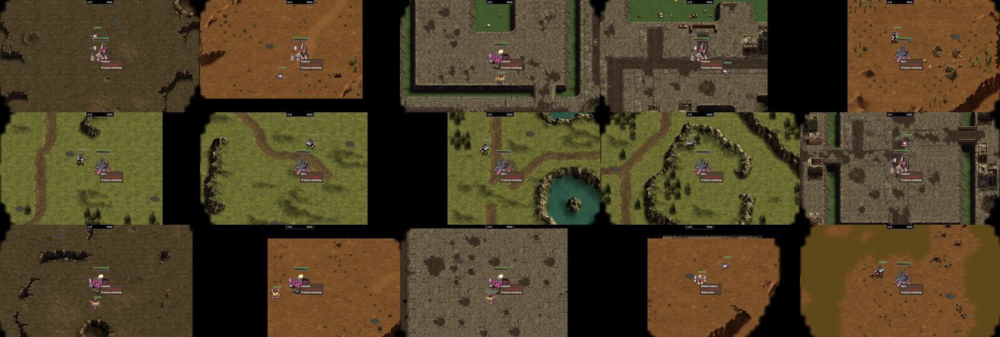

# KKND2 Thor

**Unofficial** dual-screen port of *Krush Kill 'N Destroy 2: Krossfire* for the AYN Thor handheld, built on
[OpenRA](https://github.com/OpenRA/OpenRA) and [OpenKrush](https://github.com/IceReaper/OpenKrush).
A native arm64 Android app (.NET + SDL2 + OpenGL ES 3) – no Windows emulation. Deutsch: [unten](#deutsch).

> You need your **own copy** of KKND2 Krossfire (Steam). This app contains **no game data**; graphics,
> sound, music, videos and maps are read at runtime from the files you import.

Videos: [update 0.2.0](https://youtu.be/bI8RbqBXaN0) · [showcase](https://youtu.be/qjxeIWKOAXM) · [install guide](https://youtu.be/-_eO1crVv4I)

- **Top screen:** the battlefield, full screen, no sidebar. Touch: tap = select / command,
  drag = selection box, two-finger drag = scroll, two-finger tap = deselect.
- **Bottom screen (deck):** drawn in the look of your faction – the game's own sidebar button plates, symbols
  and bitmap font are read from your imported files (Survivors metal, Evolved stone, Series 9 steel).
  - **Build menus** Infantry / Vehicles / Buildings / Defense behind the game's own menu buttons, one queue
    per factory, the game's unit and building pictures, cost in oil, progress and queue count. Tap = build or
    queue (buildings: tap, then place on the top screen), long-press = hold, again = cancel.
  - **Research:** every building with its tech level; a tap sends a free research lab to raise it, a second
    tap stops it.
  - **Oil:** stock, drill rigs, tankers, power stations and the oil left under your rigs; game clock.
  - **Minimap** (tap/drag = jump) with blinking attack alerts, selection with pictures and health.
  - **Control groups 1–0:** hold = store the selection, tap = pick it, tap again = look at it; each tile
    shows the group's unit picture and size.
  - **Commands:** Deploy, Stop, Attack-move, Move, Waypoint, Scatter, Stance, Sell, Repair, All army,
    Same type, Base, Alert (last attack), Pause, Speed (1× / 1.5× / 2× / 0.5×), Find (the selection), Save, Menu.
- **Controller:** left stick = cursor, right stick = scroll, A = left click, B = right click / deselect,
  X = stop, Y = attack-move, L3 = deploy, L1/R1 = focus ring over the build and research cards (A activates),
  L2/R2 = deck tab, D-pad = groups 1–4, Select = menu, Start = Enter.
- **Content:** Survivors, Evolved and Series 9 in skirmish against the AI on the 15 original multiplayer
  maps (converted on the device; the ground is drawn straight from the original level files).
  Original announcer, unit voices, sound effects and music; the intro videos play. Saving works (loading: see limits).
  60 fps on the Thor.

| Attack | Victory | Evolved | Series 9 |
|---|---|---|---|
|  |  |  |  |

Screenshots: AYN Thor, rendered from the author's own Steam copy.

## Install

1. **Own the game:** *Krush Kill 'N Destroy 2: Krossfire* on Steam (App 1292180).
2. **Copy the game folder to the Thor**, at least `levels`, `music` and `fmv`:
   - **From a PC:** Steam → right-click the game → Manage → Browse local files → copy the folder
     `KKND 2 Krossfire` over USB to the Thor (internal storage or SD card, e.g. `Download`).
   - **With DroidDeck on the Thor:** install the game in DroidDeck's Steam. Android does not let other apps
     read DroidDeck's folder, so copy `Android/data/com.droiddeck.launcher/files/steam/steamapps/common/KKND 2 Krossfire`
     with a PC over USB to a normal folder first.
3. **Install the APK** from the [latest release](../../releases/latest).
4. **First start:** tap **Choose Steam folder** and pick `KKND 2 Krossfire` → *Use this folder* → *Allow*.
   About 560 MB are copied into the app's folder (SD card if present) and the 15 maps are built.
5. **Play:** Singleplayer → Skirmish, add a computer player, Start Game. Tap **Deploy** on the deck to
   set up your Outpost.

Saves: `Android/data/de.harmssi.thorkknd2/files/support/Saves`.

## Known limits (v0.2.0)

- **No campaigns** yet (17 missions per faction need their own mission scripts). Skirmish only.
- No aircraft; balance follows OpenKrush's unfinished 2020 KKND2 rules, not tuned against the original.
- Only the English sound set and the English video sound tracks are used.
- Multiplayer over the network is untested.
- Loading a saved game can come back "out of sync" and paused once units were trained or research was done
  before saving. The deck has Save but no Load button for that reason.
- Tested on the AYN Thor (Android 13) with the Steam version.

## Build

`thor/build.sh [--install]` builds `dist/ThorKKND2.apk` in Docker on a Linux host (`thor/docker/Dockerfile`;
settings in `~/.config/thorkknd2/env`: `THOR_BUILD_HOST`, `THOR_BUILD_DIR`, `ANDROID_SERIAL`). The OpenRA
engine is fetched by `fetch-engine.sh` and patched with `thor/apply-engine-patches.sh` (bundled assemblies,
frame hook for controller input, MonoVM fix). Native libraries (SDL2, OpenAL Soft, FreeType, Lua 5.1) are
built from source (`thor/native/build-native.sh`). `thor/dev/check.sh` runs the OpenRA utility checks.
UI images: `thor/gen_uibits.py`, `thor/make_glyphs.py`, icon `thor/make_icon.py`.

## Credits and license

- [OpenRA](https://github.com/OpenRA/OpenRA) – engine, GPLv3.
- [IceReaper/OpenKrush](https://github.com/IceReaper/OpenKrush) – KKND file formats, mechanics and the
  original KKND2 rules (branch `old_defective_kknd2`), GPLv3.
- [Dzierzan](https://github.com/Dzierzan) – KKnD/OpenKrush work and the KKnD fork that started this.
- SDL2 (zlib), OpenAL Soft (LGPL-2.1), FreeType (FTL), Lua 5.1 (MIT), Inter and JetBrains Mono (OFL-1.1).
- UI images in `mods/openkrush_gen2/uibits` and the app icon are original work, CC0.

This port is free software under the GNU GPL v3 (see `COPYING`). *Krush Kill 'N Destroy* and *KKND* are
trademarks of their respective owners. This is an unofficial fan project, not affiliated with or endorsed
by them. You need your own game files.

---

## Deutsch

**Inoffizieller** Dual-Screen-Port von *Krush Kill 'N Destroy 2: Krossfire* für den AYN Thor, auf Basis von
OpenRA und OpenKrush. Native arm64-Android-App, keine Windows-Emulation.

> Du brauchst deine **eigene Kopie** von KKND2 Krossfire (Steam). Die App enthält **keine Spieldaten**.

**Videos:** [Update 0.2.0](https://youtu.be/bI8RbqBXaN0) · [Showcase](https://youtu.be/qjxeIWKOAXM) · [Installationsanleitung](https://youtu.be/-_eO1crVv4I)

- **Oben:** Spielfeld im Vollbild ohne Seitenleiste. Touch: Tippen = auswählen/befehlen, Ziehen =
  Auswahlrahmen, zwei Finger = scrollen, Zwei-Finger-Tipp = abwählen.
- **Unten (Deck):** im Aussehen deiner Fraktion – Knopfplatten, Symbole und Schrift des Spiels kommen zur
  Laufzeit aus deinen importierten Dateien. Baumenüs (Infanterie / Fahrzeuge / Gebäude / Abwehr, je Fabrik
  eine Warteschlange; Tippen = bauen, lange drücken = anhalten, nochmal = abbrechen), **Forschung** (Gebäude
  mit Technikstufe, Tippen = erforschen), Öl-Übersicht (Bohrtürme, Tanker, Kraftwerke, Öl im Boden), Minikarte
  mit Angriffsalarm, Auswahl, **Kontrollgruppen 1–0** (halten = speichern, tippen = wählen, nochmal = hinsehen)
  und Aufbauen, Stopp, Angriff, Bewegen, Wegpunkt, Streuen, Haltung, Verkaufen, Reparieren, Armee, Gleiche,
  Basis, Alarm, Pause, Tempo, Finden, Speichern, Menü.
- **Controller:** linker Stick = Cursor, rechter Stick = Scrollen, A = Linksklick, B = Rechtsklick,
  X = Stopp, Y = Angriffsbewegung, L3 = Aufbauen, L1/R1 = Fokus über die Bau- und Forschungskarten (A löst aus),
  L2/R2 = Deck-Reiter, Steuerkreuz = Gruppen 1–4, Select = Menü, Start = Enter.
- **Inhalt:** Survivors, Evolved und Series 9 im Gefecht gegen die KI auf den 15 Original-Mehrspielerkarten,
  Original-Ansagen, Stimmen, Effekte und Musik, Intro-Videos, Speichern/Laden, 60 fps.

**Installation:** Spielordner `KKND 2 Krossfire` (mindestens `levels`, `music`, `fmv`) aufs Gerät kopieren –
vom PC (Steam → Verwalten → Lokale Dateien durchsuchen) oder aus DroidDecks Steam-Ordner per PC in einen
normalen Ordner. APK aus dem [Release](../../releases/latest) installieren, **Steam-Ordner wählen** antippen,
`KKND 2 Krossfire` auswählen. Dann Einzelspieler → Gefecht, Computer-Gegner hinzufügen, starten und unten
**Aufbauen** tippen.

**Grenzen von v0.2.0:** keine Kampagnen, keine Flugzeuge, Werte nicht ans Original angeglichen, nur
englischer Tonsatz, Netzwerkspiel ungetestet.

Dank an OpenRA, IceReaper/OpenKrush und Dzierzan. Lizenz: GNU GPL v3. Inoffiziell, nicht mit den
Rechteinhabern verbunden; eigene Spieldaten nötig.
